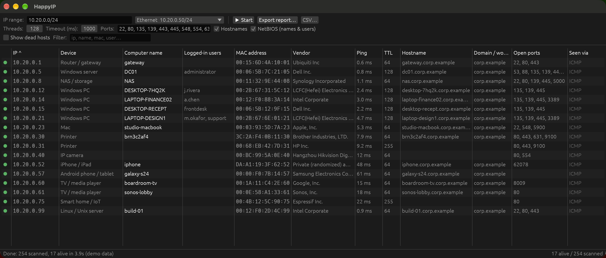
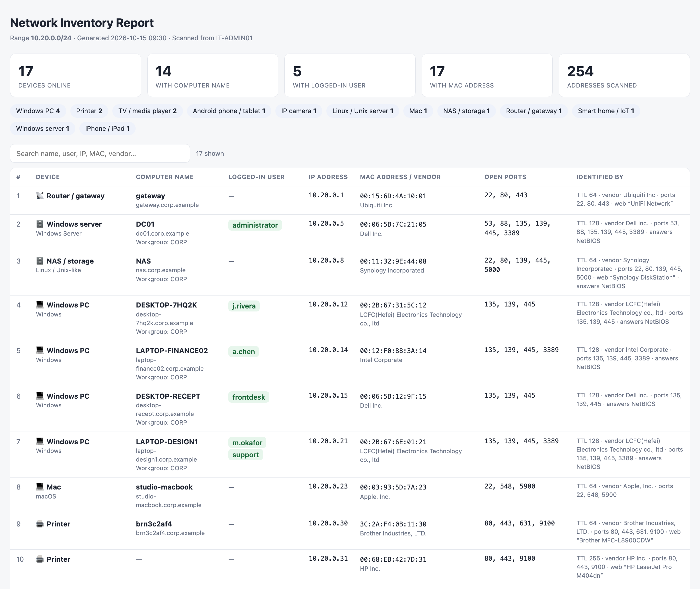
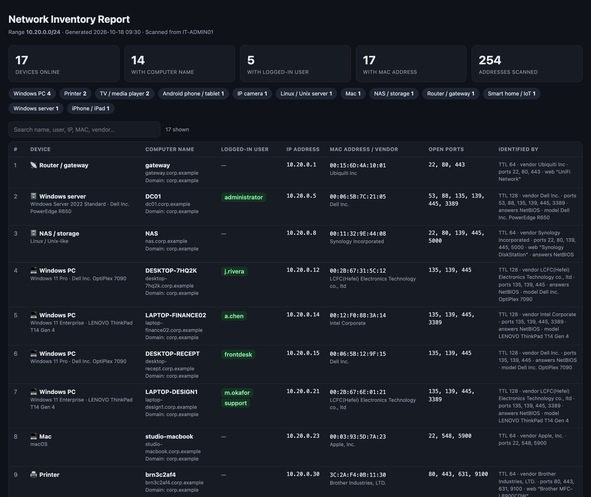

<p align="center">
  
</p>

<h1 align="center">HappyIP</h1>

<p align="center">
  A fast, friendly network scanner for <b>Windows</b> and <b>macOS</b>, in the spirit of Angry IP Scanner.<br>
  Find every device on your network with its <b>computer name, logged-in user, MAC address, vendor and device type</b>,
  then export a clean report.
</p>

<p align="center">
  <a href="https://github.com/marcoazeem/happyip/releases/latest"></a>
  
  
  <a href="LICENSE"></a>
</p>

<p align="center">
  
</p>

> Screenshots use HappyIP's built-in demo data (`--demo`). All names and addresses are fictional.

## Download

| Platform | File | Runs on |
|---|---|---|
| **Windows** | [HappyIP-Windows-x64.exe](https://github.com/marcoazeem/happyip/releases/latest/download/HappyIP-Windows-x64.exe) | Windows 10 / 11 and Server 2016+ (64-bit). Also built to run on Windows 7 / 8 and Server 2008 R2 / 2012 (these need the [Universal C Runtime](https://support.microsoft.com/help/2999226) update). |
| **macOS** | [HappyIP-macOS.dmg](https://github.com/marcoazeem/happyip/releases/latest/download/HappyIP-macOS.dmg) | macOS 11 Big Sur or later, Apple Silicon and Intel (universal) |

There's nothing to install on Windows: it's a single portable `.exe`. On Mac, open the DMG and drag **HappyIP** into **Applications**.

<details>
<summary><b>First launch: "Windows protected your PC" / "Apple could not verify…"</b></summary>

HappyIP isn't code-signed with a paid certificate yet, so your OS will warn you the first time:

- **Windows SmartScreen:** click **More info → Run anyway**. If Windows Firewall asks, allow access so NetBIOS name and user lookups get replies.
- **macOS Gatekeeper:** right-click (or Control-click) HappyIP in Applications → **Open** → **Open**.
  On macOS 15+ you may need **System Settings → Privacy & Security → Open Anyway**. Or from Terminal:
  ```sh
  xattr -dr com.apple.quarantine /Applications/HappyIP.app
  ```
  Allow **Local Network** access when macOS asks, or the scan won't see other devices.
</details>

## Features

- **Fast multithreaded scanning:** a typical /24 home or office network takes a few seconds (128 threads by default).
- **Finds devices that ignore ping:** combines ICMP ping, TCP probes (open *or refused* ports both mean "alive"), the ARP table and NetBIOS.
- **Computer names:** reverse DNS plus NetBIOS names and workgroups for Windows and Samba machines.
- **Logged-in users:** from NetBIOS, your own machine's sessions, and on Windows optionally `query user /server:` (see [limits](#good-to-know)).
- **MAC address + manufacturer:** the full IEEE vendor registry (58,000+ entries) is built in, and works offline.
- **Device type detection:** Windows PC/server, Mac, iPhone/iPad, Android, printer, IP camera, NAS, router, TV/media player, smart-home/IoT, Linux server. Hover a device in the app to see *why* it was classified that way.
- **Reports:** one click exports a polished, searchable, sortable **HTML report** that opens in your browser and prints to PDF. CSV export is also available.
- **Works on old servers and VMs:** uses the GPU when available and automatically falls back to CPU rendering on machines without one (Windows Server 2012, Remote Desktop, VMs).
- **Flexible ranges:** `192.168.1.0/24`, `10.0.0.1-50`, `10.0.0.1 - 10.0.3.254`, or several separated by commas. It auto-detects your network.
- Sort by any column, filter as you type, right-click a row to copy IP / MAC / hostname / users, or **Remote Desktop** straight into it (`mstsc` on Windows; the Microsoft *Windows App* on Mac).

## Network report

**Export report…** creates a single self-contained HTML file. Share it, archive it, or print it to PDF.

<p align="center">
  
</p>

<details>
<summary>Dark mode (follows your system theme)</summary>

</details>

## How it works

| Column | How HappyIP finds it |
|---|---|
| **Alive** | System `ping` (no admin rights needed), then TCP connects to common ports, then the OS ARP table, then a NetBIOS query. "Seen via" shows which one answered. |
| **Computer name** | NetBIOS name if the device answers on UDP 137, otherwise its reverse-DNS name. |
| **Logged-in users** | Names registered under the NetBIOS `<03>` suffix; `who` / `query user` for your own computer; with **Admin queries** (Windows): the console user from WMI plus `query user /server:<ip>` sessions. |
| **MAC address** | The OS ARP table (devices on your own subnet/VLAN), the MAC inside a Windows machine's NetBIOS reply, or with **Admin queries** the Windows PC's own adapter list over WMI (works across VLANs). |
| **Domain** | WMI (with **Admin queries**), else the NetBIOS domain/workgroup, else the DNS suffix of the hostname (`pc42.corp.example` → `corp.example`), which works for normal users and across VLANs. |
| **OS / model** | With **Admin queries**: the exact Windows edition and hardware model (e.g. *Windows 11 Pro · Dell Inc. OptiPlex 7090*) from WMI. |
| **Vendor** | MAC prefix looked up in the built-in IEEE OUI registry. Randomized "private" MACs (phones) are flagged. |
| **Device type** | Combines vendor, TTL (128 = Windows, 64 = Linux/Apple/Android, 255 = embedded), open ports (e.g. 9100 printer, 62078 iPhone, 554 camera, 8009 Chromecast, 548 Mac), hostname patterns, the HTTP page title / `Server` header, and whether it's your default gateway. |

## Command line

```sh
happyip --cli 192.168.1.0/24                       # scan and print live hosts as TSV
happyip --cli 192.168.1.0/24 --report report.html  # ...and write the HTML report
happyip --demo                                     # open the app with fictional sample data
happyip --software                                 # force CPU rendering
```

On Windows, `--cli` output is only visible from a debug build or when redirected (`HappyIP.exe --cli … > out.txt`), because the release `.exe` is a GUI app.

## Good to know

- **Admin queries (Windows):** run HappyIP as a domain admin (or *Run as different user* with an account that is admin on the targets). The PCs must allow remote WMI (the *Windows Management Instrumentation* firewall rules, typically enabled by Group Policy in managed domains). Without admin rights you still get names, domains (from DNS) and device types, but not logged-in users.
- **MAC addresses across VLANs:** ARP only sees your own VLAN, and Windows Firewall answers NetBIOS only from the local subnet by default. For Windows PCs on other VLANs, enable **Admin queries**. Non-Windows devices (printers, phones, cameras) on other VLANs don't expose their MAC remotely; only the router/switch knows it.
- **Logged-in users on other PCs** need **Admin queries**. Modern Windows rarely advertises the user over NetBIOS. Phones, Macs and IoT devices don't expose users at all.
- **MAC addresses on macOS:** recent macOS versions may hide hardware addresses from apps (the ARP table comes back empty). The MAC and Vendor columns can then be blank on Mac. Windows is unaffected.
- **Remote Desktop** connects by DNS name when one is known, so domain accounts sign in with Kerberos (no certificate warning on domain PCs). Your account needs RDP access on the target (e.g. member of *Remote Desktop Users* or a local admin).
- **Device types are best-effort guesses.** The report's *Identified by* column shows the clues behind each one.
- **Only scan networks you own or are authorized to scan.**

## Build from source

Requires [Rust](https://rustup.rs) (stable).

```sh
git clone https://github.com/marcoazeem/happyip && cd happyip
cargo run --release
```

**Release packages**

```sh
scripts/package-macos.sh     # → dist/HappyIP-macOS.dmg (universal .app, needs macOS + Xcode CLT)
scripts/package-windows.sh   # → dist/HappyIP-Windows-x64.exe (cross-compiled; needs `brew install mingw-w64`)
```

On Windows you can also just run `cargo build --release`, but note that Rust's standard Windows targets only support **Windows 10+**. `package-windows.sh` uses the `x86_64-win7-windows-gnu` target (pinned nightly + `build-std`) so the exe also runs on Windows 7/8 and Server 2008 R2/2012.

**Project layout**

| File | Purpose |
|---|---|
| `src/main.rs` | GUI (egui/eframe), CLI, exports |
| `src/scanner.rs` | Multithreaded scan engine |
| `src/probe.rs` | Ping, TCP probes, ARP table parsing |
| `src/netbios.rs` | NetBIOS node-status queries, user sessions |
| `src/identify.rs` | MAC vendor lookup, HTTP banners, device classification |
| `src/report.rs` | HTML report |
| `src/demo.rs` | Fictional demo network |
| `data/oui.tsv` | IEEE OUI vendor registry |

## Credits

- UI built with [egui](https://github.com/emilk/egui); CPU fallback via [egui_software_backend](https://github.com/DGriffin91/egui_software_backend).
- MAC vendor data: the IEEE Registration Authority's public OUI registry, as compiled in [Wireshark's `manuf` file](https://www.wireshark.org/download/automated/data/manuf).
- Inspired by [Angry IP Scanner](https://angryip.org).

## License

[MIT](LICENSE)
